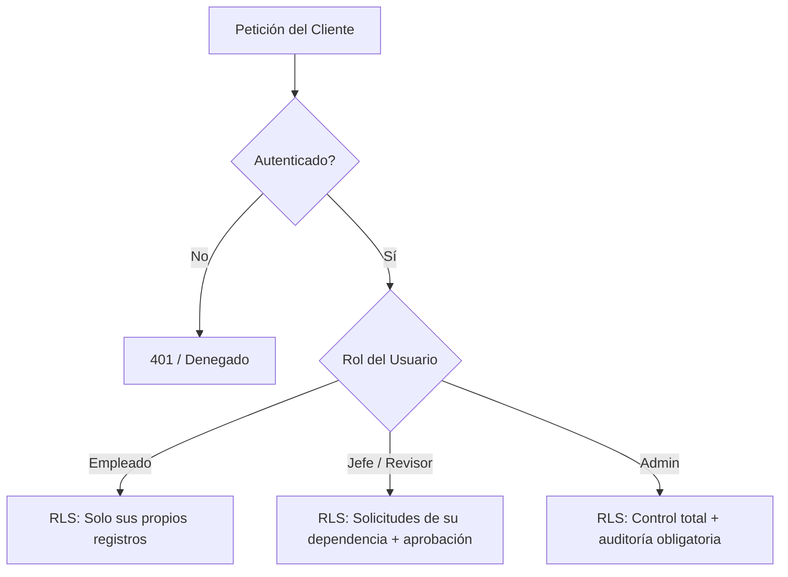

# Arquitectura de Datos y Matriz de Seguridad Supabase

Este documento detalla la estructura completa de base de datos, relaciones, procedimientos almacenados y la matriz de políticas de seguridad por niveles de fila (RLS - Row Level Security) implementadas para el **Aplicativo de Gestión de Horas Extras**.

---

## 1. Esquema de Base de Datos y Tablas

El sistema opera bajo el esquema relacional estructurado en PostgreSQL sobre Supabase:

| Tabla | Tipo | Descripción | Relaciones Clave |
| :--- | :--- | :--- | :--- |
| `departments` | Maestra | Dependencias y áreas de la organización. | Creado por `auth.users(id)` |
| `profiles` | Maestra | Perfiles laborales extendidos asociados a cuentas. | `auth.users(id)` ON DELETE CASCADE, `departments(id)`, `job_grades(id)`, `unions(id)` |
| `work_types` | Maestra | Tipos de jornada laboral (diurna, nocturna, etc.). | Creado por `auth.users(id)` |
| `work_shifts` | Maestra | Catálogo de turnos y equivalencias horarias. | Vinculado a `profiles.shift_code` |
| `job_grades` | Maestra | Catálogo de cargos, grados y rangos salariales. | Vinculado a `profiles.job_grade_id` |
| `unions` | Maestra | Catálogo de sindicatos (SINTRAELECOL, SIPROESSA, etc.). | Vinculado a reglas y asignaciones |
| `union_cost_rules` | Regla | Reglas de recargos y multiplicadores por sindicato. | `unions(id)` |
| `union_food_rules` | Regla | Tarifas y parámetros de auxilios de alimentación. | `unions(id)` |
| `labor_rules` | Regla | Parámetros legales (límites de horas, CST, recargos). | Vigencia temporal |
| `app_parameters` | Configuración | Parámetros globales en JSONB (jefe inmediato, etc.). | `updated_by` -> `auth.users(id)` |
| `overtime_requests` | Transaccional | Solicitudes de horas extras y radicados `HE-NN`. | `profiles(id)` (empleado), `departments(id)`, `work_types(id)` |
| `request_history` | Auditoría | Trazabilidad de cambios de estado y revisiones. | `overtime_requests(id)` ON DELETE CASCADE, `profiles(id)` (actor) |
| `overtime_cost_snapshots` | Transaccional | Desglose y liquidación de costos de la solicitud. | `overtime_requests(id)` ON DELETE CASCADE |
| `attachments` | Soporte | Metadatos de archivos adjuntos a solicitudes. | `overtime_requests(id)` ON DELETE CASCADE, `profiles(id)` (owner) |
| `notifications` | Comunicación | Notificaciones dirigidas por usuario. | `profiles(id)` (recipient) ON DELETE CASCADE, `overtime_requests(id)` |
| `audit_log` | Auditoría | Registro inmutable de acciones críticas y seguridad. | `profiles(id)` (actor) |
| `employee_directory` | Nómina | Directorio base de funcionarios para vinculación. | `profiles(id)` (vínculo 1:1) |
| `user_settings` | Preferencias | Preferencias individuales validadas (JSONB). | `profiles(id)` ON DELETE CASCADE |
| `manager_signatures` | Firmas | Firmas digitales autorizadas para jefes inmediatos. | `profiles(id)` (manager) |
| `salary_history` | Laboral | Historial salarial del funcionario por vigencias. | `profiles(id)` (employee) |
| `union_assignments` | Laboral | Historial de pertenencia a sindicatos. | `profiles(id)` (employee), `unions(id)` |
| `employee_compensation` | Laboral | Salario base consolidado vigente. | `profiles(id)` |

---

## 2. Matriz de Seguridad y Políticas RLS (Principio de Mínimo Privilegio)

Todas las tablas tienen `ROW LEVEL SECURITY` habilitado (`ENABLE ROW LEVEL SECURITY`). Las políticas garantizan que ningún usuario pueda ver o modificar datos fuera de su ámbito de autorización:

### Detalle de Políticas por Tabla:

| Tabla | Operación | Política / Regla RLS |
| :--- | :--- | :--- |
| `profiles` | SELECT | Todo usuario autenticado puede leer perfiles básicos (nombres, cargos). |
| `profiles` | UPDATE | Empleados solo actualizan campos personales no sensibles (cargo libre si no tiene grado). Administradores actualizan roles y estados mediante RPC seguro. |
| `overtime_requests` | SELECT | Empleado ve sus propias solicitudes (`employee_id = auth.uid()`). Jefes ven las solicitudes de su departamento. Administradores ven todas. |
| `overtime_requests` | INSERT / UPDATE | Solo a través de `public.save_overtime_request(...)` con validación de estados (`draft`, `pending`), solapamiento horario y cálculo de horas en servidor. |
| `overtime_requests` | DELETE | Solo solicitudes en borrador (`draft`) por su propio autor, o vía procedimiento por el administrador. |
| `request_history` | SELECT | Visible si el usuario puede ver la solicitud asociada (`can_see_request`). |
| `request_history` | INSERT | Inserción restringida a triggers del sistema y funciones `security definer`. |
| `attachments` | SELECT | Propietario del soporte o personal con permiso sobre la solicitud. |
| `attachments` | INSERT / DELETE | Solo el propietario mientras la solicitud esté en borrador; o administrador. |
| `notifications` | SELECT / UPDATE / DELETE | Estrictamente el destinatario (`recipient_id = auth.uid()`). Eliminación autorizada mediante migración v10. |
| `audit_log` | SELECT | Exclusivo para administradores (`public.is_admin()`). |
| `audit_log` | INSERT | Gestionado por funciones del servidor; el usuario solo puede registrar eventos de contraseña propios validados (`log_password_event`). |
| `employee_directory` | SELECT | Exclusivo para administradores (`public.is_admin()`). Inserción/actualización restringida a service_role / SQL Editor. |
| `user_settings` | SELECT / UPDATE | Exclusivo para el dueño (`user_id = auth.uid()`) mediante `save_my_settings(...)`. |
| `manager_signatures` | SELECT / INSERT | Lectura en ámbito de firma; subida y gestión reservada para administradores con auditoría. |

---

## 3. Storage Buckets y Políticas de Archivos

Se configuran dos buckets privados:

1. **`overtime-supports`** (Privado, límite 10 MB, tipos MIME: PDF, JPEG, PNG, DOCX):
   - Inserción: `(storage.foldername(name))[1] = auth.uid()::text` (los usuarios solo suben a su propia carpeta de usuario).
   - Lectura: Propietario o administrador / revisor en ámbito.
   - Eliminación: Propietario en borrador o administrador.
2. **`manager-signatures`** (Privado, límite 2 MB, tipo MIME: PNG):
   - Inserción / Eliminación: Exclusivo para administradores.
   - Lectura: En ámbito de visualización y exportación de formatos aprobados.

---

## 4. Funciones Críticas del Lado del Servidor (`SECURITY DEFINER`)

Para evitar cualquier manipulación de datos desde la consola del navegador:

1. `save_overtime_request`: Valida horas solicitadas, fechas no futuras, coherencia de intervalos y pertenencia.
2. `perform_request_action`: Valida transiciones válidas de la máquina de estados (`approve`, `reject`, `return`, `validate`, `close`). Impide que el administrador apruebe sus propias solicitudes laborales.
3. `compute_overtime_cost`: Realiza el cálculo matemático de recargos nocturnos, dominicales y festivos en el motor PostgreSQL utilizando el calendario oficial de festivos en Colombia (`is_co_holiday`, algoritmo de Pascua).
4. `admin_set_password` (Edge Function): Protege la asignación de credenciales con control de tasa (rate limiting: 20 por admin/10min, 5 por usuario/hora) y revocación inmediata de sesiones activas (`revoke_user_sessions`).
